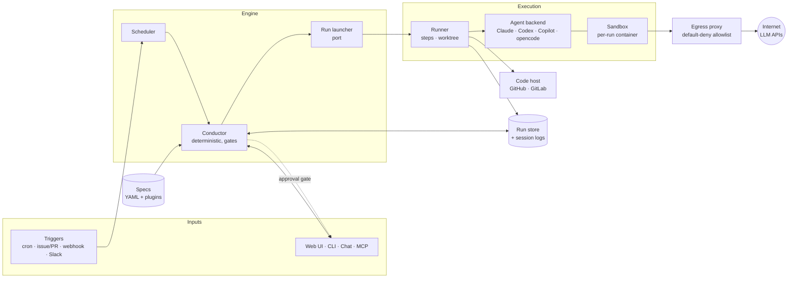

# fabrikant — the software factory

Define agentic development loops as YAML specs, run them locally, steer them from the web UI or a chat. One
engine process (`fabrikant serve`) watches triggers and executes loops; the UI at `http://127.0.0.1:8321` shows
projects, loops, runs, live logs and a chat interface.

**Key idea: autonomy with gates.** The conductor is deterministic code, agents are replaceable workers. Git
projects run in isolated worktrees, results go out as a branch + PR (never a push to `main`), and loops run on
their own — only steps you mark as critical (`approval: true`) pause until a human approves.

## How it fits together

Deployment-neutral view: every box is a replaceable component behind a port, so the same engine runs on a laptop,
a server or (via a different run launcher) a cluster.



Agents never reach the internet directly: all egress goes through the allowlist proxy, and results leave as a
branch + PR on the code host. Component details: [architecture](docs/architecture.md).

## Install

Python 3.11+:

```bash
pip install fabrikant
# or: docker run -p 8321:8321 -v fabrikant-data:/data ghcr.io/<owner>/fabrikant
```

## Getting started

```bash
mkdir my-factory && cd my-factory
fabrikant init                          # projects/hello.fabrikant.yaml, fabrikant.env, plugins/ skeleton
fabrikant validate                      # check the specs
fabrikant run hello greet               # run the hello example once
fabrikant serve                         # engine + UI + scheduler on http://127.0.0.1:8321
```

A spec is a few lines of YAML (the hello example, bundled with `fabrikant init`):

```yaml
name: hello
root: .
loops:
  greet:
    tier: 1
    steps:
      - {type: shell, name: say-hello, cmd: "echo hello from fabrikant"}
```

Custom steps are plain Python packages registered via the `fabrikant.steps` entry point
([docs/plugins.md](docs/plugins.md)). All commands: [docs/cli.md](docs/cli.md).

## Documentation

The full index is [docs/README.md](docs/README.md). Highlights:

- [Architecture overview](docs/architecture.md) and [roadmap](docs/roadmap.md)
- [Configuration](docs/configuration.md) · [spec reference](docs/spec-reference.md) · [step types](docs/steps.md) · [triggers and alerts](docs/triggers.md)
- [Agent backends](docs/backends.md) · [runs](docs/runs.md) · [relay tasks](docs/relay.md)
- [Chat and LLM providers](docs/chat.md) · [HTTP API](docs/api.md) · [authentication](docs/auth.md) · [security](docs/security.md)
- [Operations](docs/operations.md) (systemd, workers, worktrees) · [development](docs/development.md) · [releasing](docs/releasing.md)
- [Architecture decisions (ADRs)](docs/adr/README.md)

## License

Open core: the engine, CLI, UI, spec format and plugin contract are Apache 2.0 ([LICENSE](LICENSE)). Details:
[docs/licensing.md](docs/licensing.md).
