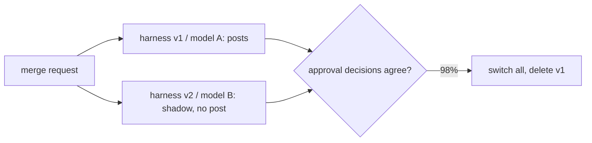
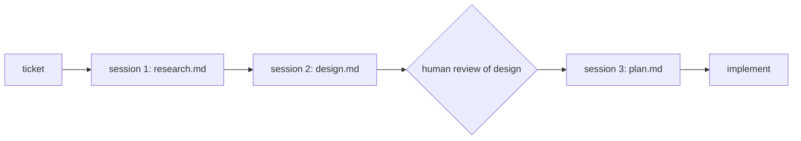
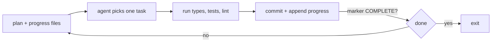

# Findings

### F1 — Per-turn cost drift: measure cost per review by tier, not in aggregate
Category: concept
Source: https://blog.cloudflare.com/obsessive-inference-optimization/
Cloudflare's internal AI code reviewer went from about $1.19 per review (April) to about $2.46 (end August) without any architectural change. They tracked cost per review per risk tier, so a day with more large reviews did not skew the trend. Most of the increase came from model changes, with a smaller share from more reviews landing in the "full review" tier. fabrik records runs, but nothing tells us the cost trend per loop or step. Without that, a creeping cost increase stays invisible until the bill arrives.

### F2 — Most agent spend is context re-read, so prompt-cache prefix stability is a design constraint
Category: concept
Source: https://blog.cloudflare.com/obsessive-inference-optimization/
In Cloudflare's reviewer, output tokens were only about 23% of spend. Cache writes (43%) and cache reads (34%) made up the rest, because every LLM call re-sends the whole conversation. A session made about 16.6 calls and wrote 72k tokens while reading 1.08M back from cache. Cost therefore grows with both call count and context size. For fabrik this means prompt order matters: stable material (tools, system prompt, shared rules) goes first and per-run material (repo, date, working directory) goes last.

### F3 — Per-repo content in front of the shared prompt silently killed cache hits
Category: error-scenario
Source: https://blog.cloudflare.com/obsessive-inference-optimization/
Cloudflare logged token usage and a hash of the first system block for each session's first call. Only 14–26% of first requests hit a cached prefix, although 11–21k tokens were identical across repos. The cause was the harness building one system block that mixed the agent prompt with environment details (working directory, date), with a single cache breakpoint at the end. The fix was to split the block at a marker so the shared half got its own breakpoint, and to keep anything repo-specific out of the front. The detection method is the transferable part: log the first-call cache-read ratio and the prompt-prefix hash for each run.

### F4 — Inline the reference index so sessions stop spending their first turns reading files
Category: prompt
Source: https://blog.cloudflare.com/obsessive-inference-optimization/
The standards reviewer spent its first three turns reading index files via tool calls. Putting the reference index (a table of standards, the skill file and the list of reference files) directly into the prompt cut LLM calls per run from 15.9 to 9.6 and cost per run from $1.12 to $0.72. For fabrik's builder, reviewer and planner prompts, the question to ask is which orientation files every run reads anyway. Those belong in the prompt, in the cacheable prefix.

### F5 — Don't give sub-agents tools the server will reject
Category: error-scenario
Source: https://blog.cloudflare.com/obsessive-inference-optimization/
Sub-reviewers could see the tool for posting the final review comment. In 57–76% of sessions they tried it, the server-side check rejected the call, and they spent another call recovering. Removing the tool saved a call and about 2.9k tokens of tool definitions per request. The rule is that an agent's tool list should match its role. Permission enforcement belongs in the server, but showing the tool still wastes calls. fabrik's builder and reviewer identities (ADR 0010) could also get role-scoped tool sets.

### F6 — Skip re-reviews when nothing new changed, and make timeouts and cancellations explicit
Category: pattern
Source: https://blog.cloudflare.com/obsessive-inference-optimization/
About two-thirds of Cloudflare's review jobs were a second or later review of the same merge request, often with nothing new for some reviewers to look at. They skip individual specialist reviewers on re-reviews: AGENTS.md reviews were skipped 56% of the time, performance reviews 23%, documentation reviews 13%. Two operational findings sit alongside this. A reviewer hitting its time limit was treated like a provider failure and restarted with the same limit, so they raised the limits and lowered effort. And in a sample of 446 cancelled CI jobs, 358 kept running to completion because the executor sent no signal, so jobs now poll their own status every 15 seconds. fabrik's `on_pr` reconcile per head SHA (ADR 0023) covers part of the first point; per-step skipping and cancel propagation are worth checking.

### F7 — Shadow-mode canary and randomized splits for changing agent harness or model
Category: pattern
Source: https://blog.cloudflare.com/obsessive-inference-optimization/
Before moving all reviews from OpenCode v1 to v2, Cloudflare ran every review in every canary repo on both versions in shadow mode. The two agreed on the approval decision in 98% of merge requests, and they then switched everyone and deleted v1. Model changes (Opus 5 to 5.5, Sonnet 5 to 5.5) and effort levels were evaluated with 50/50 randomized splits on live traffic, comparing cost, latency and findings. They note their before/after comparisons of code changes are not a controlled experiment. fabrik already treats model choice as config (ADR 0022); what is missing is a built-in way to run two configs side by side and compare outcomes.

### F8 — A cheaper reviewer is only good if findings are checked against author actions
Category: concept
Source: https://blog.cloudflare.com/obsessive-inference-optimization/
After the cost cuts, Cloudflare's reviewers posted 40–71% fewer critical or warning findings. They explicitly say this alone does not show whether real problems are missed or noise is cut. Their check was whether authors act on what the reviewer flags, plus a test of whether extra effort brings findings back. At high effort the code-quality reviewer cost 61% more and posted 58% more findings. fabrik has no review-quality signal beyond the verdict, so any cost optimisation there would be blind.

### F9 — Task-scoped consent: grant the narrowest subset of a requested scope
Category: pattern
Source: https://blog.cloudflare.com/task-based-oauth-consent/
Cloudflare OAuth now lets a client mark scopes optional so a user can approve a narrower subset at consent time. They give MCP servers as the motivating case: a server may request broad permissions because an agent could use them all, but users rarely want that. The issued token holds only the consented scopes, so a client must check the granted set and cope with a narrow grant instead of assuming the full one. The same idea applies to an agent loop: request only the scopes the task needs and let the agent run with whatever it receives. For fabrik this suggests per-loop or per-step credential scopes, so a loop that needs only issue read plus branch push does not carry a token that can do more.

### F10 — Unread, unreviewed agent-written code failed within months
Category: error-scenario
Source: https://newsletter.pragmaticengineer.com/p/context-engineering-with-dex-horthy
Dex Horthy (HumanLayer) ran an experiment from July 2025 where a model wrote code and no human reviewed it. After four months they threw the whole system away. Production broke, and the model could not find the root cause however it was prompted. A human spent days tracing a wrongly routed primary key through the codebase, then three weeks re-onboarding to code nobody had read. For fabrik this supports keeping human gates on design and architecture even in "autonomous" loops, and shows that the cost of unreviewed code is deferred and hard to detect in the short term.

### F11 — Benchmark-trained models can degrade a codebase over time
Category: concept
Source: https://newsletter.pragmaticengineer.com/p/context-engineering-with-dex-horthy
Horthy's hypothesis is that coding models are optimized on SWE-bench-style tasks that reward reproducing a known fix, and that bad architecture cannot be scored by running unit tests. This is why agents slowly make a codebase worse even when each change passes. His suggested eval is to have a model build 20 features in a row without knowing what comes next. Today fabrik's review step judges one diff at a time. A periodic whole-codebase quality signal (complexity or architecture drift) would be a different kind of check.

### F12 — The "dumb zone": keep context utilization well under the window limit
Category: concept
Source: https://newsletter.pragmaticengineer.com/p/context-engineering-with-dex-horthy
As a rule of thumb, less context used gives better outcomes, because attention cost grows quadratically. Horthy stops at about 300–400K tokens on a 1M window, and about 100K on smaller models. Beyond that, models begin doing stupid things such as deleting a .env file. A bigger window does not mean a smarter model. fabrik agent steps could track context usage and end or hand off a step before the threshold instead of running until the window fills.

### F13 — Research, design, plan: compress context into Markdown between fresh sessions
Category: pattern
Source: https://newsletter.pragmaticengineer.com/p/context-engineering-with-dex-horthy
Horthy's workflow for complex work starts with one session that reads a lot of code and emits a research document. A second session takes the ticket plus the research and writes a design document. A third session takes both and writes a plan. The human is in the loop where leverage is highest, which is reviewing the design document. Each session starts fresh from the compressed Markdown, not from a long noisy transcript. This maps directly onto fabrik's multi-step loops, where each step could hand off an artifact (research.md, design.md, plan.md) rather than rely on shared conversation state.

### F14 — Sycophantic "You're absolutely right" replies signal a poisoned trajectory
Category: error-scenario
Source: https://newsletter.pragmaticengineer.com/p/context-engineering-with-dex-horthy
Horthy treats phrases like "you're completely right" or "you're right to push back" as a sign to start a new session. Models are autoregressive, so a loop of mistake, user complaint, more mistakes keeps predicting another mistake. He lists four things that matter in a context window: size, information quality (an early error is treated as fact by every later turn), missing information (the agent guesses), and trajectory. fabrik retry or fix-up steps could detect these phrases or repeated failures and restart from a clean session with a summary, instead of appending another correction to the same conversation.

### F15 — Slow loops: nightly agents that open PRs for a human to merge
Category: pattern
Source: https://newsletter.pragmaticengineer.com/p/context-engineering-with-dex-horthy
HumanLayer runs a nightly automation where an agent fixes one thing in the codebase and opens a pull request. It started with one and now runs four agents producing four PRs by morning, all focused on code quality improvements. A person still reads each PR before merging. This is a low-risk, scheduled loop that fits fabrik's cron trigger. It also shows how to introduce autonomy gradually: small, bounded tasks with a human merge gate.

### F16 — Three ways to run a software factory, with measured productivity claims
Category: concept
Source: https://newsletter.pragmaticengineer.com/p/context-engineering-with-dex-horthy
Horthy sees three options. "Lights off" (no code review, hoping AI doesn't create too much slop) was tried and failed. Reviewing all AI-generated code slows work to human speed, with an expected 30–50% productivity lift over pre-AI work. The third is to spend the saved time on leverage (design, architecture, key decisions) and not insist on reading all generated code, which he estimates as 2–3x faster than hand-written code. These are his own estimates, not measurements. They are still a useful way to frame fabrik's autonomy levels: where exactly the human gate sits.

### F17 — Don't optimise model cost early; use cheap models for simple steps once scale justifies it
Category: concept
Source: https://newsletter.pragmaticengineer.com/p/context-engineering-with-dex-horthy
Horthy advises starting with the smartest available model because engineering time is the bottleneck, and only optimising LLM and context usage once costs are real. At that point a very cheap model (he names GPT-OSS-120B at about 1/1,000th the cost of Opus) can handle simpler steps. This matches fabrik's model-as-config approach (ADR 0022). A gap is per-step model selection by task difficulty, along with the data to decide which steps can move down.

### F18 — "Token harder" versus "token smarter"
Category: concept
Source: https://newsletter.pragmaticengineer.com/p/context-engineering-with-dex-horthy
Horthy contrasts maximising token consumption (for example, sharing tips on maxing out subscriptions) with getting the most value while keeping control. He regards the second as harder to do. For fabrik, quota and cost governance matters more than raw throughput: per-run budgets, per-project budgets and alerts when a loop burns tokens without producing a merged result.

### F19 — Build your own pipeline rather than depend on a big agent framework
Category: pattern
Source: https://newsletter.pragmaticengineer.com/p/context-engineering-with-dex-horthy
Horthy reports that around August 2024 he talked with about 100 AI engineers doing real work, such as 00K+ enterprise contracts. Many had tried frameworks like LangChain and CrewAI and dropped them in favour of their own pipelines. His "12-Factor Agents" guide came out of that. This supports fabrik's approach of a small, stdlib-based engine with explicit steps. The linked 12-factor-agents repository would be a primary source for later sessions.

### F20 — Close the loop: design so the agent can verify its own work
Category: pattern
Source: https://newsletter.pragmaticengineer.com/p/the-creator-of-clawd-i-ship-code
Peter Steinberger (creator of OpenClaw) says agents must be able to compile, lint, execute and validate output themselves, and he designs systems for that. He also runs tests locally through the agents instead of waiting about 10 minutes for remote CI. fabrik's builder step could require a verify command before handing off, and fabrik could give the agent a fast local feedback path before the slower remote CI and review stages.

### F21 — Review the prompt and plan, not only the code
Category: prompt
Source: https://newsletter.pragmaticengineer.com/p/the-creator-of-clawd-i-ship-code
Steinberger describes pull requests as "prompt requests": he is more interested in the prompts that produced the code than in the code, and talks about architecture with his core team instead of reviewing code. He spends a long time going back and forth with an agent on a plan, challenging and tweaking it, before kicking it off. This is a single practitioner on an experimental project, and the episode notes that context. Still, it suggests recording the plan and prompt as first-class artifacts in the PR, so a reviewer can judge intent before diff.

### F22 — Running 5–10 agents in parallel needs planned, queued work
Category: pattern
Source: https://newsletter.pragmaticengineer.com/p/the-creator-of-clawd-i-ship-code
Steinberger queues several agents on different features at once and stays in flow by planning each task carefully first. He prefers an agent that goes off and does long-running tasks over one that keeps returning with clarifying questions, once a fleshed-out plan exists. fabrik's worker pool already runs several loops. The relevant lesson is that parallelism pays off when each task arrives with a plan that makes questions unnecessary, so fabrik should measure how often runs stall on questions.

### F23 — A single model gateway enables spend tracking, security checks and audit
Category: pattern
Source: https://newsletter.pragmaticengineer.com/p/ubers-ai-infra-from-the-inside
Uber decided in 2023 that everything built with AI must be model- and harness-agnostic, and built a Model Gateway to switch between vendors and open models. On top of it sit AI Guard (security middleware checking requests and responses and flagging slow models), per-user spend tracking, audit logs and session traces. fabrik today picks a CLI backend per step (see ADR 0005, 0022). A thin gateway or logging layer would give one place for cost, redaction and audit across all backends.

### F24 — Tiered spend allocation with manager sign-off instead of hard caps
Category: concept
Source: https://newsletter.pragmaticengineer.com/p/ubers-ai-infra-from-the-inside
Uber gives engineers a spend tier. When someone hits the limit, a manager can approve more for the month. A CostCheck plugin gives tips across sessions on how to improve an engineer's cost profile, and Uber reports about 50% lower token costs over a few months. fabrik could model budgets the same way, as a soft per-project tier with an approval gate when exceeded (reusing its approval mechanism), not a hard stop mid-run.

### F25 — Code review is the bottleneck: pre-review with AI, risk scores and evidence
Category: pattern
Source: https://newsletter.pragmaticengineer.com/p/ubers-ai-infra-from-the-inside
All PRs at Uber are still reviewed by engineers. Review has become a big bottleneck, so before a human opens a change the AI review has already run, screenshots or videos are attached where applicable, and a risk score is assigned so reviewers can decide how much time to spend. This lines up with fabrik's cross-model review step (ADR 0003, 0024). The gap is the risk score and evidence attachment, which would let a human gate scale.

### F26 — CI load explodes with agents; move cheap checks into the inner loop
Category: error-scenario
Source: https://newsletter.pragmaticengineer.com/p/ubers-ai-infra-from-the-inside
Uber had to declare an internal "code red" for CI earlier this year because CI jobs more than doubled in 12 months. The fix was to move simple jobs (linting, build template rules) into an inner loop so agents run a validate command before opening a PR. A fabrik factory that opens many PRs will hit the same pressure on shared CI, so a pre-PR validation step is a gap to check.

### F27 — Measure agent output by PR type instead of PR velocity
Category: concept
Source: https://newsletter.pragmaticengineer.com/p/ubers-ai-infra-from-the-inside
With agents it is easy to create dozens or hundreds of PRs, many with no business impact, so PR velocity stops being meaningful. Uber now tags every PR as feature, bugfix, maintenance, testing or docs, and watches the share of feature PRs rise while maintenance falls. fabrik's run records could carry a work-type tag and a "merged and useful" outcome, so loops are judged on outcomes instead of run count.

### F28 — The Ralph loop: same prompt, agent picks the next task, explicit completion signal
Category: pattern
Source: https://www.aihero.dev/tips-for-ai-coding-with-ralph-wiggum
Matt Pocock describes "Ralph": run a coding CLI in a loop with one fixed prompt. Each iteration reads a plan file and a progress file, lets the agent choose the highest-priority task, runs feedback checks, appends to the progress file, and commits. The agent emits a completion marker (a `<promise>COMPLETE</promise>` tag) when nothing is left, and the loop script exits on it. The key difference from multi-phase prompting is that the agent chooses the task and a human defines only the end state. fabrik loops are YAML steps; a task-queue style loop with a machine-checkable done signal would be a new loop shape.

### F29 — Start human-in-the-loop, then go unattended, and always cap iterations
Category: concept
Source: https://www.aihero.dev/tips-for-ai-coding-with-ralph-wiggum
The article separates a supervised mode (one iteration, watched) used to learn and refine the prompt from an unattended mode that runs a loop with a maximum iteration count. The author warns that infinite loops are dangerous with stochastic systems and typically uses 5–10 iterations for small tasks and 30–50 for larger ones. This is a concrete autonomy ladder. fabrik has approval gates and a worker pool, but no per-loop iteration cap or "supervised first" mode as a documented concept.

### F30 — A committed progress file plus git history carries state across fresh context windows
Category: pattern
Source: https://www.aihero.dev/tips-for-ai-coding-with-ralph-wiggum
Each iteration writes a short progress entry (tasks done, decisions and why, blockers, files changed) committed in the repo, which the next iteration reads instead of re-exploring the codebase. The author says to delete it after the sprint, because it is session-specific. He credits Anthropic's article on long-running agent harnesses for the idea. This is the same idea as this relay's own HANDOFF.md, and it suggests fabrik loops could define a standard handoff artifact between runs and between steps.

### F31 — Feedback loops are the quality lever, and a failing check should block the commit
Category: concept
Source: https://www.aihero.dev/tips-for-ai-coding-with-ralph-wiggum
The article lists types, unit tests, a browser automation server for UI, lint and pre-commit hooks as feedback loops. The best setup blocks commits unless everything passes, so the agent cannot declare victory with red tests. It also says the rate of feedback is the speed limit, so work should be cut into small steps. A fabrik builder step could enforce this with a required verify command and a pre-commit hook, not just an instruction in the prompt.

### F32 — Prioritise risky and architectural tasks first, and give humans those
Category: prompt
Source: https://www.aihero.dev/tips-for-ai-coding-with-ralph-wiggum
Left alone, an agent tends to take the first or easiest item, like a developer chasing quick wins. The article suggests telling it to order work: architecture and core abstractions, integration points, unknowns and spikes, then standard features, with polish last. It reserves supervised mode for the early architectural work because those decisions persist, and unattended mode for later low-risk tasks. A planner prompt for fabrik could carry this ordering, and the human gate could be placed on tasks tagged as architectural.

### F33 — Tell the agent what quality bar the repository has
Category: prompt
Source: https://www.aihero.dev/tips-for-ai-coding-with-ralph-wiggum
The agent cannot tell whether it is in a throwaway prototype or production code that must be maintained for years, so the prompt should say so. The article gives example wording per repo type (prototype versus production) and expected behaviour. A fabrik project spec could carry a quality-bar field that is injected into builder and reviewer prompts, so both apply the same standard.

### F34 — Sandbox unattended runs so a runaway agent cannot touch the host
Category: pattern
Source: https://www.aihero.dev/tips-for-ai-coding-with-ralph-wiggum
The article's answer to "what stops it running a destructive command while I am away" is a container sandbox with only the working directory mounted, which blocks home directory, SSH keys and system files. The tradeoff is that global instructions and user skills are not loaded. The author calls this essential for overnight loops and optional when watching. fabrik isolates work in git worktrees, which protects the main checkout but not the rest of the host. Container or OS-level sandboxing for unattended loops is worth tracking as a gap.

### F35 — Oversized AGENTS.md files cost tokens on every request and make the agent worse
Category: error-scenario
Source: https://www.aihero.dev/a-complete-guide-to-agents-md
Every rule added after an agent misstep accumulates into a "ball of mud" that nobody reviews as a whole, and conflicting rules appear when several people edit it. The article cites an "instruction budget": roughly 150–200 instructions can be followed with reasonable consistency by frontier models, fewer for smaller ones. Because the file is loaded on every request, bloat costs tokens and distracts the agent. It also warns against auto-generated files and against documenting file paths, which go stale and send the agent to the wrong place. This repo's own CLAUDE.md is very large, so a size check would apply here.

### F36 — Use progressive disclosure for agent instructions instead of one big file
Category: pattern
Source: https://www.aihero.dev/a-complete-guide-to-agents-md
The fix recommended is to keep the root file minimal and move task-specific guidance into separate documents the agent reads only when relevant, with the same approach per package in a monorepo. The article also offers a prompt for cleaning up a broken file. For fabrik this suggests loading instructions per step (builder, reviewer, planner) and per task type, and linting the size of the instructions it injects into each step.

### F37 — Self-improving harness: an editor proposes changes, tested against the baseline run
Category: pattern
Source: https://www.all-ai.de/news/news26/google-harness-start
all-ai.de (German) reports Google Research's open-source Harness², which lets an agent revise its own working environment for a task while the model weights stay fixed. It edits eight components: system prompt, rules, memory, skills, tool hints, scripts, subagents and plugins. For each task the agent first runs the existing configuration, then an editor produces two candidates (one for general weaknesses in planning, tool use or context handling, one for the task domain), and both run under the same conditions against the baseline. A composer keeps a change only if the behaviour shows it solved a concrete problem. No reference answer or grader is needed. fabrik could do something similar for its prompts, but would need an offline A/B harness over past runs.

### F38 — Keep task-specific lessons in a library, not in the shared base configuration
Category: concept
Source: https://www.all-ai.de/news/news26/google-harness-start
In Harness², a second recursion level stores the chosen harness and its evidence in a library. A later task starts again from the shared base configuration and pulls in matching components and past insights selectively. The stated aim is to prevent rules tailored to one task from being passed on to all others. The reported result is gains in all four model-harness combinations on three benchmarks (up to 11.8 percentage points for one improvement step), with larger parallel or sequential budgets adding more. This is a reported research result, not independently checked. It parallels the instruction-bloat problem in F35 and suggests fabrik keep per-project learnings separate from loop defaults.

### F39 — Juniors need to learn to verify AI code, not only write code
Category: concept
Source: https://www.all-ai.de/news/news26/microsoft-praise-programmierer
all-ai.de reports Microsoft's PRAISE programme for early-career developers, which pairs experienced mentors with participants working with AI, plus Carnegie Mellon courses. Participants practise understanding what generated code does, questioning assumptions, and discussing unusual changes with colleagues. The underlying question from Microsoft's Russinovich and Hanselman is how people learn the craft when AI drafts and fixes code. For fabrik this is a human-gate design issue: if humans only approve diffs produced by agents, the skill needed at the gate can erode, so reviews should come with explanations and evidence a human can check.

### F40 — Review on two independent axes: standards and spec, never blended
Category: prompt
Source: https://www.aihero.dev/skills-code-review
The code-review skill reviews a diff against a fixed point along two axes. "Standards" asks whether the change follows the repository's documented conventions, and "Spec" asks whether it implements what the originating issue asked for. Each axis runs in its own sub-agent so neither sees the other's reasoning, and the report names the worst issue per axis instead of one merged verdict. A change can pass one axis and fail the other, and a blended score lets the passing axis hide the failing one. For fabrik's reviewer this suggests splitting the review prompt into a convention check and an issue-acceptance check.

### F41 — Repo documentation outranks a generic smell baseline; no spec means say so
Category: prompt
Source: https://www.aihero.dev/skills-code-review
The standards axis reads whatever the repo documents (coding standards, contributing guide) and only falls back to a built-in list of code smells when nothing is documented. Smells are labelled as heuristics ("possible Feature Envy"), never as hard breaches. The spec axis finds the spec from issue references in commits, a path argument, or a spec file matching the branch, and otherwise reports "no spec available" instead of inventing requirements. The point for fabrik is that a reviewer should be told to cite a rule or a spec line for every finding, and to say so when it has nothing to check against.

### F42 — Hand off by file: portable, references instead of copies, secrets redacted
Category: pattern
Source: https://www.aihero.dev/skills-handoff
The handoff skill writes one small Markdown file with the live thread (what is in flight, why, what is next) plus the skills the next agent should use. It points to specs, plans, ADRs, issues and commits by path or URL and never copies them, so settled detail lives in one place and cannot drift. Secrets are redacted before the file is written. The article separates three phase-boundary tools: compact preserves intent, clear preserves nothing, handoff preserves the work's ability to move. It matches what the relay handoff file already does, and suggests an explicit "reference, do not copy" rule.

### F43 — Handoff files kept in temp directories vanish between sessions
Category: error-scenario
Source: https://www.aihero.dev/skills-handoff
The most reported problem with the handoff skill is that the file goes to the OS temp directory, and some environments clear temp between sessions (the page names Codex as a reported case, and a reboot empties /private/tmp). The fix is to ask for the path back and keep it. For an unattended chain of sessions this is a real failure mode: state has to live somewhere durable, such as the branch. Fabrik's relay already commits the handoff, but scratch outputs like the /tmp extracts are lost, so anything a later session needs must be committed or re-fetchable.

### F44 — Slice tickets vertically, size each to one fresh context, and use expand-migrate-contract for wide refactors
Category: pattern
Source: https://www.aihero.dev/skills-to-tickets
The to-tickets skill splits a spec into tracer-bullet tickets: each is a narrow path through every layer that can be demonstrated alone, and each is sized to fit one fresh context window, because the session picking it up has never seen the spec. Ticket dependencies are explicit blocking edges, and nothing is published until a human approves the numbered breakdown. The page reports a team that sliced a 26-ticket stack by layer and got about twenty agent runs per closed ticket, roughly three quarters of it rework. A wide mechanical refactor is the exception and is sequenced as expand, migrate in batches, then contract. This gives fabrik's planner a concrete decomposition rule and a rework metric.
